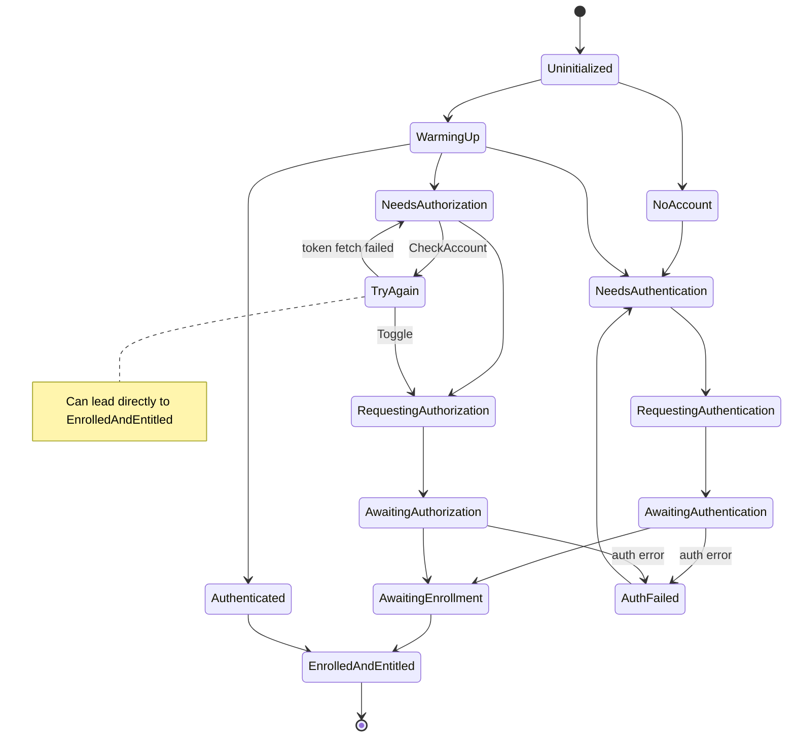

# [Android Components](../../../README.md) > Feature > IPProtection

A component which adds support for IP protection and authentication using FxA and free tier auth services.

### Setting up the dependency

Use Gradle to download the library from [maven.mozilla.org](https://maven.mozilla.org/) ([Setup repository](../../../README.md#maven-repository)):

```Groovy
implementation "org.mozilla.components:feature-ipprotection:{latest-version}"
```

### Legend

| Acronym       | Description                                                                               |
|---------------|-------------------------------------------------------------------------------------------|
| FxA           | Firefox Accounts; refers to the web auth service and the client-side integration.         |
| IPP / toolkit | IP Protection is the service that provides the built-in VPN feature.                      |
| Guardian      | The backend service of IPP that provides access to servers.                               |
| RP            | Relying party - the service/resource that has controlled access based on FxA.             |

## Firefox Account Enrollment

At this current time, the FxA implementation for entitlement requires extending our state machine to include the
`AccountStatus` with additional states that do not exist in the account manager. This is needed to register and
authorize an FxA account with a Guardian account. The mapping from FxA `AccountState` to IPP `AccountStatus` is
mostly done in `FxaAccountStoreSync`.

The authentication with FxA requires the generic `AuthCustomTabActivity` to know specifics about IPP feature by
notifying the `IPProtectionStore` when an auth flow is complete (see: `IPProtectionActivityAuthFlowObserver`). This
can be decoupled after [bug 1977876][bug-1977876].

### Authentication vs Authorization

A user can go down two Firefox Account signed-in flows that we define below:

* Authentication: there is no existing account signed-in, so a new sign-in flow will authenticate the user for the
  first time to include all the scopes that are needed for IP Protection as well as Sync.
  Prior to [bug 1977876][bug-1977876], we assume that these scopes are always `SCOPE_SYNC` and `SCOPE_PROFILE`.
  After that work is complete, the 'Authentication' flow will be largely obsolete.

* Authorization: an account on the device that was signed-in for some service (typically Sync) but we have
  determined that the account does not have the scopes needed for the IP Protection service.

### Auth flow

The diagram below draws out the major parts of the auth flows and failure states. To avoid turning the diagram into a
spaghetti of arrows with every one pointing to all the failure cases, we highlight only the important ones.

Note: This is a presentation of an IPP account and this flow can be shared between FxA and a future free-tier
system (e.g. GPI).



There are some nuances worth calling out in the FxA auth flow:

* `RequestingAuth*` and `AwaitingAuth*` represent UI states to initialize the auth activity as well as wait for the
  result before we move forward.
* `AwaitingEnrollment` represents notification for toolkit as well as offering UI observable state while it happens.
* If an account was signed-in for a different service and is therefore in `NeedsAuthorization`, we can check with
  the FxA service to see if the account has previously been upgraded to have the IPP scope with the `CheckAccount`
  action. If it is, this would trigger a token exchange that allows us to provide a valid and upgraded access token
  to IPP and skips us straight to `EnrolledAndEntitled`.
* Authorization or authentication failures always lead us to re-authorize: this ensures we go through the flow with
  all the scopes the application needs.

[bug-1977876]: https://bugzilla.mozilla.org/show_bug.cgi?id=1977876

## License

    This Source Code Form is subject to the terms of the Mozilla Public
    License, v. 2.0. If a copy of the MPL was not distributed with this
    file, You can obtain one at http://mozilla.org/MPL/2.0/
