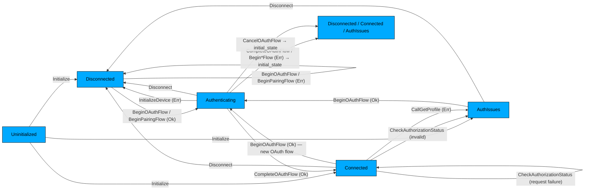

# The FxA State Machine

The FxA state machine tracks a user's authentication state as they perform operations on their account.
The state machine, its states, and its events are visible to consumer applications (Firefox iOS, Firefox Android).
Apps generally watch the state and update the UI based on it - e.g. showing a login button for `Disconnected`, or a link to the FxA account management page for `Connected`.

Events correspond to user actions or runtime triggers (clicking the login button, completing OAuth, recovering from an auth error). From a given state and event, the FSM may produce multiple possible next states depending on the result of underlying network calls, usually one for success and one for failure.

For example, when completing an OAuth flow: a successful `CompleteOAuthFlow` transitions from `Authenticating` to `Connected`; a failed one transitions back to the state we were authenticating from.

## High-level

There are two layers:

1. **`transitions.rs`** — Each `match` arm reads as: do the work, attach the target state for the error path with `.to_state_machine_err(|| target)?`, return the success state. Returns `Result<FxaState, StateMachineErr>`, the `Err` variant carries both the error cause (for logging) and the target state to land in.
2. **`helpers.rs`** — the supporting types:
   - [`StateMachineErr`] + [`ResultExt::to_state_machine_err()`] extension trait give the `?` ergonomics for "on error, transition to this state".

The driver in `mod.rs` validates the `Initialize` invariant, calls `transition()` once, routes the error (if any) through `convert_log_report_error` for logging/Sentry, commits the new state, and fires `on_auth_issues()` if applicable.

Adding a new event is straightforward: add a `match` arm in `transition()`.

## State diagram

`Authenticating { initial_state }` tracks where the user came from. Error and cancel paths from `Authenticating` return to `initial_state` (not always `Disconnected`) — so a re-auth attempt from `AuthIssues` that the user cancels lands back at `AuthIssues`, and an OAuth flow started from `Connected` that errors out keeps the user at `Connected`. The exception is `InitializeDevice` errors, which always land at `Disconnected`. A `CompleteOAuthFlow` success from `Authenticating { initial_state: Connected }` skips `InitializeDevice` because the device is already initialized.
